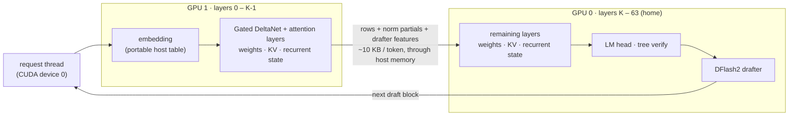

<p align="center">
  
</p>

<p align="center">
  <a href="LICENSE"></a>
  
  
  
  
  <a href="https://github.com/turbo-tan/tqllm"></a>
</p>

<h3 align="center">Two 16 GB cards. One 27B model. Half a million tokens of context.</h3>

**Tandem** is a fork of [tqLLM](https://github.com/turbo-tan/tqllm) that splits one model across two GPUs in one PC.
Qwen3.8-27B in tqLLM's TQ_L format (14.7 GB) does not load on any 16 GB card. On two it serves the model's full
262,144-token context with room to spare, and **524,288 tokens** with YaRN, while the DFlash2 drafter keeps decoding at
**127–140 tokens/s** on code. The split is **bit-exact**: greedy output on two cards equals the one-card output token for
token.

Everything that makes tqLLM fast stays: TurboQuant weights, the DFlash2 block-diffusion drafter, tree verify,
TqCache, prompt reuse and the OpenAI-compatible `tqserve`. Tandem adds the second card.

> **Status:** working and measured on 2x RTX 5060 Ti 16 GB under Windows 11. Linux builds the same code but is not yet
> measured. See [what runs](#what-runs) and the [roadmap](#roadmap).

---

## Contents

- [Results](#results)
- [Quick start (Windows)](#quick-start-windows) · full guide: [install, run, agents, troubleshooting](docs/guides/tandem.md)
- [How it works](#how-it-works)
- [Choosing the split](#choosing-the-split)
- [What runs](#what-runs)
- [Correctness](#correctness)
- [Roadmap](#roadmap)
- [Contributing](#contributing)
- [Credits](#credits)
- [License](#license)

---

## Results

2x RTX 5060 Ti 16 GB (448 GB/s each, PCIe, no NVLink), Windows 11, CUDA 13.2. Greedy, thinking off, 512 output tokens.

### Speed

| Setup | GPUs | Context | Code tok/s | Prose tok/s | Long prompt (26.9K tokens) |
|---|:-:|--:|--:|--:|---|
| llama.cpp (DSpine fork), Unsloth UD-Q6_K + DSpine drafter | 2 | 65,536 | 82–104 | 32 | — |
| tqLLM, TQ_XS (3-bit) + DFlash2 | 1 | 65,536 | 170–172 | 97 | prefill 1,120 tok/s, decode 88 |
| **Tandem, TQ_L (4-bit class) + DFlash2** | **2** | **524,288** | **127–140** | **81** | **prefill 826 tok/s, decode 63** |
| Tandem, Unsloth UD-Q6_K (22 GB, llama.cpp GGUF) + DFlash2 | 2 | 131,072 | 86–96 | 57 | — |
| Tandem, TQ_XS split (overhead check) | 2 | 8,192 | 196–200 | 80–85 | — |

Prefill (prompt reading, unique prompts, median of three): TQ_L at 131K context 1,099 tok/s for a 9.7K-token prompt
and 1,044 for 36.7K; UD-Q6_K 957 and 895. Plain llama.cpp GGUFs (K-quants, IQ) split the same way as the TQ formats.

The last row is the price of the split itself: the same model on one card runs at 205 / 81 tok/s, so the hand-off
between the cards costs almost nothing once each card replays its own captured graph.

### Context

| Context | How | Needle test (a planted passphrase) | Prefill |
|--:|---|---|---|
| 262,144 | trained length | found at 159,491 tokens (25 % deep) | 574 tok/s |
| 262,144 | trained length | found at 248,390 tokens (50 % deep) | 478 tok/s |
| **524,288** | YaRN x2 | **found at 459,444 tokens (35 % deep)** | 348 tok/s |

A follow-up turn reuses the previous prompt (`--prompt-cache on`): the same 26.9K-token prompt is read again in
about 0.2 s instead of 33 s.

### Quality

A 20-task coding check (Python functions, each run against unit tests):

| Model | Score |
|---|:-:|
| Unsloth UD-Q6_K (llama.cpp) | 20 / 20 |
| **TQ_L, Tandem split, 131K or 524K (YaRN x2)** | **19 / 20** |
| TQ_XS (3-bit, one card) | 17 / 20 |

The split never changes a token (see [correctness](#correctness)); the score reflects the weights' quantization.

---

## Quick start (Windows)

**You need** two NVIDIA GPUs (RTX 20 series or newer; tested on 2x RTX 5060 Ti 16 GB), Visual Studio 2022 Build Tools
with the C++ workload, the CUDA Toolkit 12.8+ (13.x tested), CMake 3.25+ and Ninja.

**1. Build** from an "x64 Native Tools Command Prompt for VS 2022":

```bat
git clone https://github.com/aseprahman04/tqllm-tandem.git
cd tqllm-tandem
cmake -S . -B build -G Ninja -DCMAKE_BUILD_TYPE=Release -DCMAKE_CUDA_ARCHITECTURES=120 -DBUILD_TESTING=OFF
cmake --build build --target tqserve
```

Set `CMAKE_CUDA_ARCHITECTURES` to your cards: `86` RTX 30, `89` RTX 40, `120` RTX 50.

**2. Download** the model, the drafter and its vocabulary from
[YTan2000/Qwen3.8-27B-TQ](https://huggingface.co/YTan2000/Qwen3.8-27B-TQ):

```bat
hf download YTan2000/Qwen3.8-27B-TQ Qwen3.8-27B-TQ_L.gguf drafters/Qwen3.8-27B-DFlash2-TQ3.gguf ^
  mtp-vocab/atx_65536.txt --local-dir models
```

**3. Serve** across both cards ([`scripts/windows/tandem-serve.bat`](scripts/windows/tandem-serve.bat) does the same):

```bat
set CUDA_VISIBLE_DEVICES=0,1
set TQLLM_SPLIT=44
build\tqserve.exe --model models\Qwen3.8-27B-TQ_L.gguf ^
  -md models\drafters\Qwen3.8-27B-DFlash2-TQ3.gguf --draft-vocab models\mtp-vocab\atx_65536.txt ^
  --context 524288 --kv tq3 --kv-host 0 --prompt-cache on ^
  --rope-scaling yarn --rope-scale 2 --yarn-orig-ctx 262144 --port 8086
```

The log says where each part went:

```
tqllm: layer split: layers 0-43 on GPU 1, 44-63, the head and the drafter on GPU 0
tqserve: listening on 127.0.0.1:8086 (model=tqllm, context=524288)
```

**4. Use it** like any OpenAI server at `http://127.0.0.1:8086/v1` (chat completions, Anthropic messages, streaming,
tools), or open a coding agent on it in one command: `scripts\windows\tandem-agent.bat claude` (or `codex`,
`opencode`, `pi`). `GET /props` reports the loaded context as llama.cpp does, so agents that size their compaction window from it
work unchanged. Drop `--rope-scaling ...` and use `--context 262144` for the trained length without YaRN.

---

## How it works



- **Layer (pipeline) split, not tensor parallelism.** A verify block's hidden rows cross between the cards once,
  not twice per layer, so a plain PCIe slot is enough; GeForce cards without peer access stage the copy through host
  memory automatically (`cudaMemcpyPeerAsync`).
- **One engine, two device contexts.** tqLLM's qwen35 engine keeps its stream, cuBLAS handle and about 70 scratch
  buffers as members. `use_dev()` swaps them between the cards, after making the new card's stream wait for
  everything queued on the old one. Each layer's weights, KV cache and recurrent state are allocated on the layer's
  card; device 0 also holds the head and the drafter.
- **Home on device 0.** `cudaSetDevice` is per host thread and the server's request threads start on device 0, so the
  home stage lives there and every call returns there.
- **Captured graphs per card.** A verify block runs as two CUDA graphs, one per card, with the hand-off between them.
  Prefill chunks, commits and tree gathers run eagerly.
- **Per-device kernel limits.** Kernels needing more than 48 KB of shared memory set that limit per device
  (`PerDeviceLimit`); a process-wide "set once" guard leaves the second card at the default.

The engine changes are in [`src/models/qwen/qwen35/qwen35_split.cpp`](src/models/qwen/qwen35/qwen35_split.cpp) and the
hooks marked "layer split" in the qwen35 engine; the full guide is [docs/guides/multi-gpu.md](docs/guides/multi-gpu.md).

---

## Choosing the split

`TQLLM_SPLIT=K` puts layers `0 .. K-1` on CUDA device 1 and the rest on device 0. Device 0 also carries the head, the
drafter and usually the desktop, so give device 1 more layers. Every fourth layer is a full-attention layer and holds
KV; the others are Gated DeltaNet layers with a small fixed state.

KV per token with `--kv tq3`: 224 bytes per KV head in each attention layer, **14.3 KB per token** for Qwen3.8-27B.

| Context | Total KV | Fits 2x 16 GB with TQ_L? |
|--:|--:|---|
| 262,144 | 3.8 GB | yes (`K=40`: 14.1 GB / 11.3 GB) |
| 524,288 | 7.5 GB | yes (`K=44`: 12.7 GB / 14.9 GB) |
| 1,048,576 | 15 GB | no: needs host KV + TqCache compaction ([roadmap](#roadmap)) |

---

## What runs

| | Tandem split |
|---|---|
| Models | dense Qwen3.5 / 3.6 / 3.8 (`qwen35`), TQ formats and llama.cpp K-quants |
| Drafter | DFlash2 (`-md`), or none |
| Slots | one (`--np 1`) |
| KV | all on the GPUs (`--kv-host 0`), any KV format |
| Prompt reuse | `--prompt-cache on` |
| Not yet | `--mtp`, `--kv-host`, `--kv-compact`, `--np > 1`, MoE models, images |

Without `TQLLM_SPLIT` the engine is upstream tqLLM: every other model and option works as documented in
[docs/tqllm-README.md](docs/tqllm-README.md).

---

## Correctness

The split is checked by token equality, not by eye. The same server, model and options run once on one card and once
split across two; every greedy answer must match byte for byte:

```bat
python tools\tandem_golden.py --out one.json     & rem server on one GPU
python tools\tandem_golden.py --out two.json     & rem server split across two
python tools\tandem_golden.py --compare one.json two.json
```

On Qwen3.8-27B TQ_XS (it fits one card, so both runs are possible) all answers are identical, and the drafter accepts
exactly the same number of tokens in both. Failures show up loudly: a buffer on the wrong card is an illegal memory
access, which `compute-sanitizer --tool memcheck` names with its kernel.

---

## Roadmap

- **Prefill on both cards at once.** Long prompts keep the first card busy while the second waits (it holds 11 of the
  16 attention layers at `K=44`). Pipelining prefill chunks across the cards should read long prompts ~1.3x faster.
- **A million tokens.** A host KV tail with TqCache compaction (lossy) per card, or the trellis tcq3 / tcq2 KV codecs
  (~640K on the GPUs).
- **More of tqLLM under the split:** `--np > 1`, `--mtp`, MoE models, images.
- **Borrowed system RAM for bigger weights** (Q6 / Q8): a small share of the layers' weights streamed from host memory
  per verify window.
- **More than two cards**, and Linux numbers.

---

## Contributing

Contributions are welcome: numbers from other cards, Linux runs, and any item on the roadmap.

1. Open an issue with your cards, driver, CUDA version and the command line before large changes.
2. Keep the split bit-exact: run [`tools/tandem_golden.py`](tools/tandem_golden.py) on a model that fits one of your
   cards and include the comparison in the pull request.
3. Changes that are not about the split belong upstream: please send them to
   [turbo-tan/tqllm](https://github.com/turbo-tan/tqllm) (see [CONTRIBUTING.md](CONTRIBUTING.md)).
4. Mark modified upstream files with a one-line "Modified in the multi-GPU fork" note (Apache-2.0, section 4(b)).

---

## Credits

Tandem is a small layer on top of other people's work.

- **[tqLLM](https://github.com/turbo-tan/tqllm)** by **David Y. Tan (turbo-tan)**: the engine, the TurboQuant (TQ)
  weight formats, TqCache, tqserve, and the DFlash2 / DSpine integration. Everything fast here is tqLLM's.
- **[PolyStrata](https://github.com/simplexai-labs/PolyStrata)** (simplexai-labs) and
  **[Strata](https://github.com/Niko1221/Strata)** (Niko1221): their layer split for consumer cards (one stage per
  card, rows handed on through host memory, no NVLink) is the design Tandem follows. No code is copied.
- **[llama.cpp / ggml](https://github.com/ggml-org/llama.cpp)** (Georgi Gerganov and contributors): GGUF and the
  K-quant layouts, and the reference everything is compared against.
- **Qwen team (Alibaba)**: the Qwen3.8 models.
- **[z-lab](https://huggingface.co/z-lab/Qwen3.8-27B-DFlash2)**: the DFlash2 block-diffusion drafter.
- **Google Research**: TurboQuant, the transform-quantization lineage of the TQ formats.
- **[Unsloth](https://huggingface.co/unsloth)**: the UD GGUFs used as the quality and speed baseline.
- The third-party code tqLLM itself includes is listed, with its licences, in [NOTICE](NOTICE).

Maintained by [@aseprahman04](https://github.com/aseprahman04) (ARN). Built with Claude Code.

---

## License

Apache License 2.0, the same as tqLLM: see [LICENSE](LICENSE). Keep the [NOTICE](NOTICE) file, which carries tqLLM's
attribution and this fork's, with any copy. Model weights and third-party components keep their own licences.
